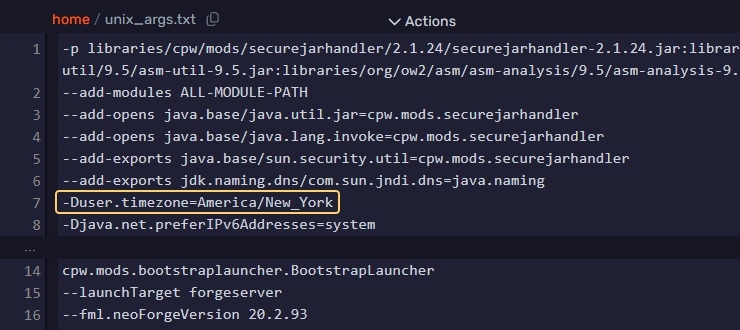
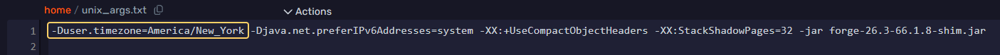

## Overview

If your pack uses a recent version of Forge or any version of NeoForge, Bloom reads `unix_args.txt` when you click **Start** in DuckPanel. This file tells Java (via flags) how to load the version of Forge or NeoForge your pack needs.

---

## Which versions use it?

- **Forge** on Bloom uses `unix_args.txt` for **Minecraft 1.17.1 and newer**, starting with Forge 37.0.0. 
- **NeoForge** on Bloom uses `unix_args.txt` for **all versions**.

---

## Where do I find unix_args.txt?

Open your server's **File Manager** in DuckPanel and go to **Home**. You'll find `unix_args.txt` directly in that directory, alongside your `mods` and `config` folders.

---

## How do I change my startup flags?

For the versions listed above, make your changes in `unix_args.txt` instead of the **Startup** tab. Open the file in **File Manager** and leave the lines added by Forge or NeoForge in place.

### NeoForge flags

Find the first group of lines starting with `--`. **Add a new line immediately after the last `--add-exports` entry.** This puts your flag with the other Java flags, before the second group of options that starts with `--launchTarget`.

In our example, `-Duser.timezone=America/New_York` goes on line 7. To edit it, change the value on line 7. To remove it, delete that line.

### Forge flags

Find `-jar` followed by your Forge JAR's name. **Add your flag to the left of `-jar` on that same line**, with a space between each argument. In our example, `-Duser.timezone=America/New_York` is at the start of line 1, and `-jar forge-26.3-66.1.8-shim.jar` is at the end.

To edit it, change only the flag's value. To remove it, delete just `-Duser.timezone=America/New_York` and leave the rest of line 1 in place.

### Applying your changes

Click **Save Content**, then restart your server from **Console** for the changes to take effect.

---

## What if the console says it couldn't open the file?

If you just uploaded a server pack, check where it was extracted. If you have to open a folder named after the pack before you can see `unix_args.txt`, [move the contents of that folder into Home](/file-manager-controls#controls-summary). Then go back to **Console** and click **Start**.

If the file is missing altogether, check which Forge or NeoForge build your pack requires. If it's NeoForge or Forge 1.17.1+ then you can install that build through **Settings** under **Change Server Type**. See our [server software guide](/jars) for the steps. By installing the server jar manually you'll also generate a fresh `unix_args.txt`.
