## Introduction

The 'Ports & Connections' tab of the DuckPanel lists every port your server has, and the connections that lead to each
one.

A connection is a name people can use instead of your server's IP address and port, such as:

- A subdomain players join with, like `yourserver.minecraft.best`
- A domain that opens a website your server runs, like `https://map.yourserver.tld` for [Dynmap](/multiplatform/dynmap)

This tab replaces the old 'Ports & Proxies' and 'Subdomain' tabs. Your existing ports, subdomains and reverse proxy
domains are all listed here.

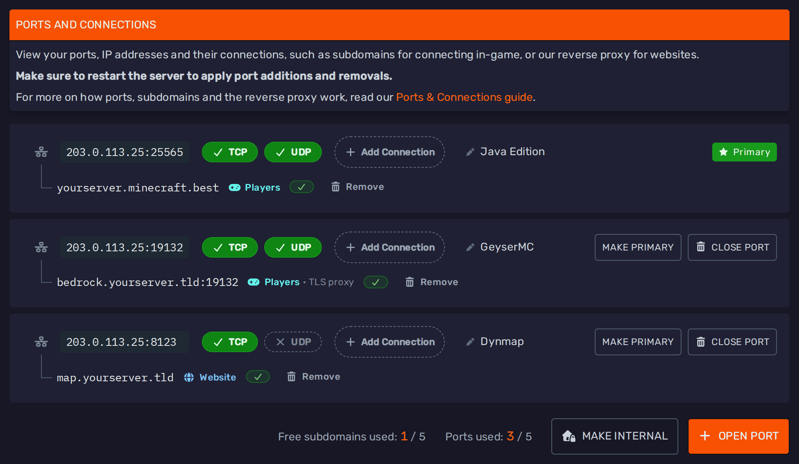

Which connection you need depends on who will use it:

| Connection                                                    | Used for                                                                          | DNS records                                                                 |
|---------------------------------------------------------------|-----------------------------------------------------------------------------------|-----------------------------------------------------------------------------|
| [Free subdomain for players](#free-subdomains-for-players)     | Players joining with a name like `yourserver.minecraft.best`                      | Set up automatically                                                        |
| [Your own domain for players](#your-own-domain-for-players)   | Players joining with a domain you bought, like `play.yourserver.tld`              | You add an A record, plus an SRV record on games that use one              |
| [Through the TLS proxy](#players-through-the-tls-proxy)       | Bedrock players ([NetherNet](/nethernet)), including Java servers with GeyserMC   | Automatic for a free subdomain, a CNAME record for your own domain         |
| [Website](#websites)                                          | Dynmap, BlueMap, Plan, NGINX, Caddy and other websites, over HTTPS                | Automatic for a free subdomain, a CNAME record for your own domain         |

---

## Ports

### Opening a Port

Plugins and mods that run their own website, voice chat or other service usually need a port of their own.

To open one, head over to the 'Ports & Connections' tab and press the 'Open Port' button at the bottom. Next to it, you
can see how many ports and free subdomains your server is using out of its limits.

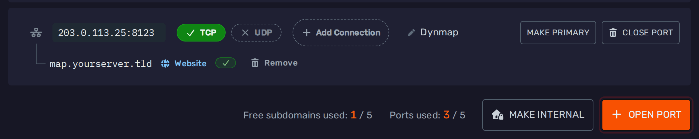

Enter the port you want, or leave it empty for a random free port, and press 'Open Port':

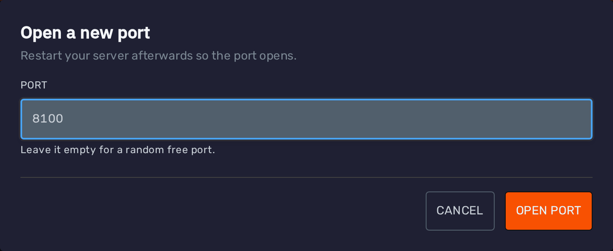

If your server has more than one IP address, you can also choose which one the port opens on.

If the port you asked for is already used by another server, you will get a different port instead, and the panel tells
you which one. Make sure to use that port in your plugin's configuration.

:::caution HEADS UP!
New and closed ports only take effect once the server restarts.
:::

If your server is running, a notice above your ports reminds you to restart it, however many changes you make. Press **Restart Now** to restart it from there, or **Later** to put the notice away:

### Managing a Port

Each port is shown as a row:

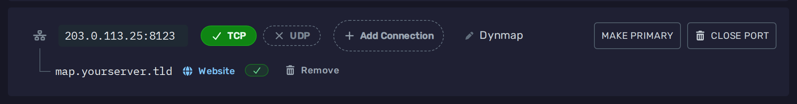

From left to right:

- **IP address and port**: Click it to copy it.
- **TCP and UDP**: The protocols the port is open on. Click one to open or close it, then restart the server. Most games
  use both, while websites only need TCP.
- **Add Connection**: Adds a name for this port, see [Adding a Connection](#adding-a-connection).
- **Note**: A note for yourself, such as what the port is used for. Click 'Add a note' to write one, and it is saved
  automatically.
- **Primary** or **Make Primary**: The primary port is the main port your server runs on. Use 'Make Primary' to make a
  different port the primary one, then restart the server.
- **Close Port**: Closes the port, see [Closing a Port](#closing-a-port).

The connections of the port are listed underneath it.

### Closing a Port

If you no longer need a port, press the 'Close Port' button on its row. Closing both TCP and UDP closes it as well.

The confirmation lists the connections that will stop working:

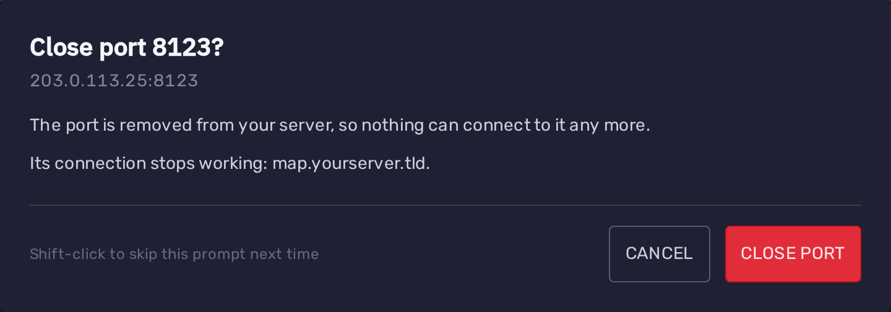

:::caution HEADS UP!
Closing a port also deletes the free subdomains on it and removes its domains. Remember to restart the server afterwards.
:::

The primary port cannot be closed. To close it, [make another port primary](#managing-a-port) first.

### Ports Opened by a Startup Setting

Some server types open ports through a setting on the 'Startup' tab, such as the gameplay ports of
a [Bedrock Dedicated Server](/nethernet#bedrock-dedicated-server).

These are grouped together with a 🔒 padlock, and you can see each of them with the 'Show Ports' button:

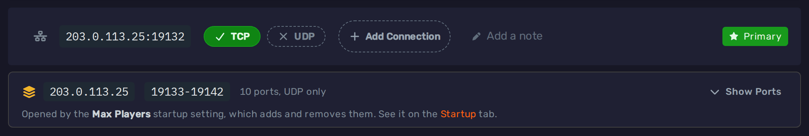

They are opened and closed by changing that setting, so they cannot be closed here and connections cannot be added to
them. They don't count towards your port limit.

### Internal Servers

The 'Make Internal' button at the bottom of the tab closes every port and removes their connections. Your server can
then only be reached by other servers in the same plan, such as a [Velocity](/velocity) proxy.

The tab then shows the address other servers can use to reach it:

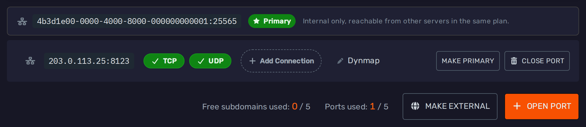

You can still open public ports on an internal server, for example for a website.
Use 'Make External' to give the server a primary port again.

For more information, see our [internal servers guide](/internal-servers).

---

## Connections

### Adding a Connection

To add a connection, press the 'Add Connection' button on the port players or the website should reach:

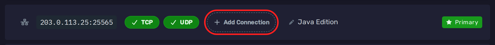

You will be asked a few questions, one at a time. The trail at the top shows where you are, and you can click an earlier
step to go back. The port you are adding the connection to is shown on the right.

1. **Who will use it**: Players in a game, or a website your server runs:

   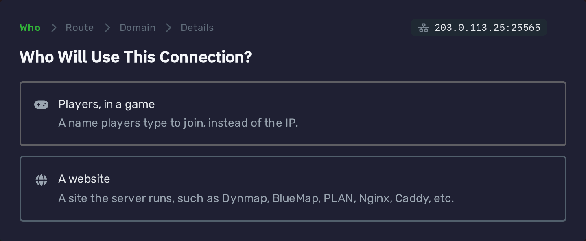

2. **How players reach the server**: Directly, which is what Java Edition and most games use, or
   [through our TLS proxy](#players-through-the-tls-proxy), which Bedrock Edition needs. The option your game needs
   is marked as recommended. Websites skip this step.

   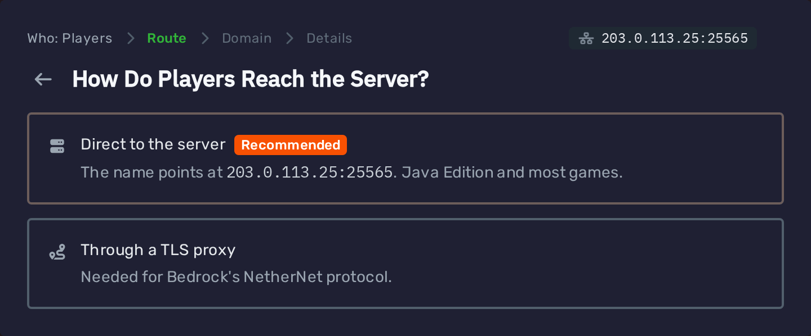

3. **Whose domain**: A free subdomain under one of our domains, or a domain you bought from a third party, such as a
   domain registrar:

   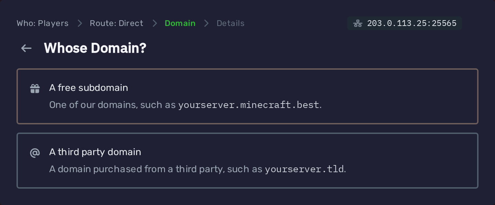

4. **Details**: What you need to fill in, depending on your answers. The sections below go through each of them.

At the top of the last step, you can see the path the connection takes, from what players or browsers type to your
server's port.

If an option cannot be used on the port you picked, it is greyed out with the reason underneath. For example, a port
that is closed on TCP cannot be reached through our proxies.

### Free Subdomains for Players

Pick 'Players, in a game', then 'Direct to the server' and 'A free subdomain'.

Enter a name for your server, pick one of our domains and press 'Create'. Names can be 2 to 32 letters and numbers,
without spaces, dots or dashes.

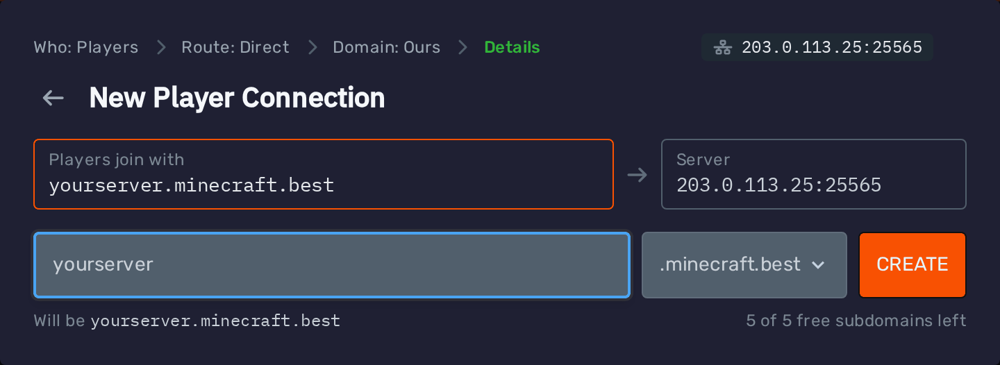

The DNS records are set up for you automatically:

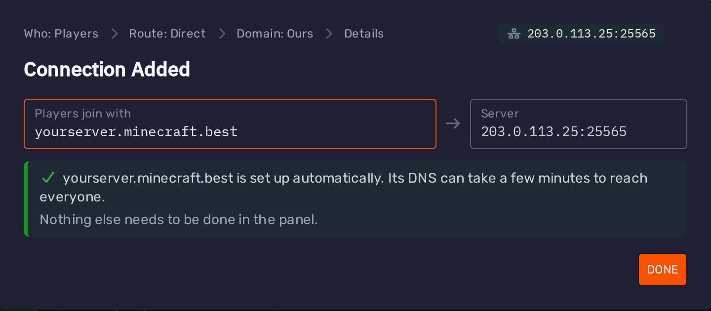

Depending on the game, the subdomain gets an A record, or an A record and an SRV record. On Minecraft Java Edition,
players can join with just the subdomain, such as `yourserver.minecraft.best`. On games without an SRV record, players
may also need to add the port, which the tab shows next to the connection.

It can take a few minutes until a new subdomain works for everyone.

Each server can have a limited number of free subdomains, counting every kind together. The form shows how many you have
left, and the bottom of the tab shows how many are in use. To make another one once they are used up,
[remove](#removing-a-connection) one first.

### Your Own Domain for Players

Pick 'Players, in a game', then 'Direct to the server' and 'A third party domain'.

The panel shows the DNS records to add at your domain's DNS provider, which is usually where you bought the domain, or
Cloudflare:

- An **A** record that points your domain at your server's IP address
- On games that use one, such as Minecraft Java Edition, an **SRV** record, so players don't need to type the port

Once you have added them, type your domain into the box and the panel checks that its A record points at your server.
The SRV record cannot be checked there, so make sure it matches the one shown. Without it, players have to type the port
as well:

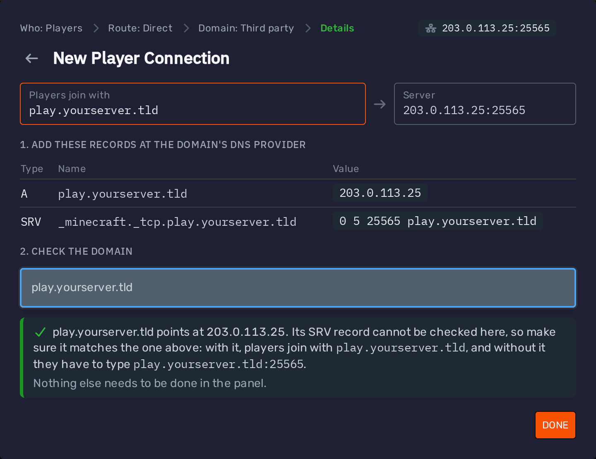

There is nothing else to do in the panel. These records live entirely at your DNS provider, so the domain is not listed
in the tab.

:::caution HEADS UP!
These records point straight at your server's IP address. If you use Cloudflare, set them to **DNS only** (grey cloud),
since a proxied A record leads to Cloudflare instead of your server.
:::

For step-by-step instructions on adding these records in Cloudflare, see our [domain guide](/domain).

### Players Through the TLS Proxy

Minecraft Bedrock Edition connects to servers with [NetherNet](/nethernet). iOS only allows that over a secure (HTTPS)
connection, which our TLS proxy adds in front of your server's port. This also removes the "trust on first use" prompt
for everyone else.

You need this for:

- [Bedrock servers](/nethernet#bedrock-dedicated-server): Add it to the primary port, which is the TCP signaling port.
- Java servers running [GeyserMC](/multiplatform/geysermc): Add it to Geyser's port, such as `19132`, not to the
  Java port.

Pick 'Players, in a game', then 'Through a TLS proxy'. The port needs to be open on TCP.

**For a free subdomain**, pick 'A free subdomain', enter a name and press 'Create'. The DNS is set up automatically:

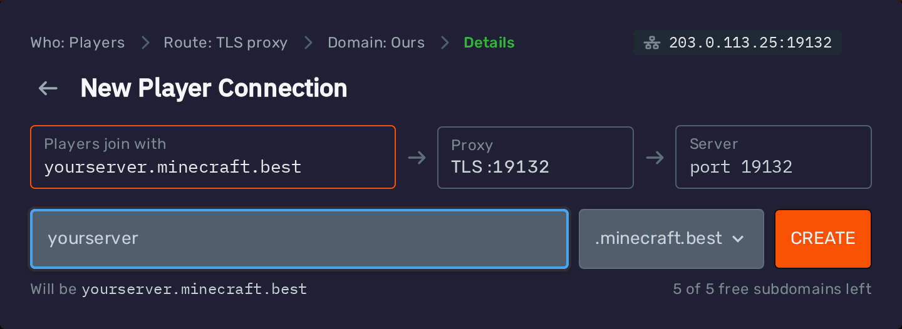

**For your own domain**, pick 'A third party domain':

1. At your domain's DNS provider, add the **CNAME** record shown, which points your domain at our proxy.
   See [Adding a CNAME Record](#adding-a-cname-record).
2. Type your domain into the box. It is checked as you type, and you can press 'Add' once the record is found.

:::caution HEADS UP!
If you use Cloudflare, set the record to **DNS only** (grey cloud). Cloudflare's proxy (orange cloud) only passes web
ports on, so players could not join through it, and the panel will not add the domain.
:::

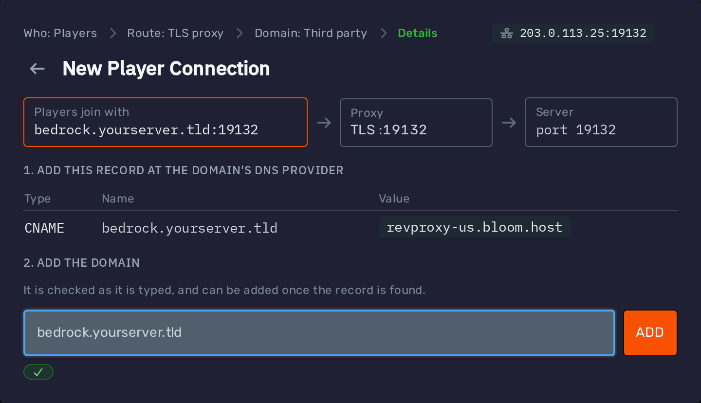

The proxy uses the same port number as your server's port, so players join with the name and that port. For example,
for `bedrock.yourserver.tld` on port `19132`, Bedrock players enter `bedrock.yourserver.tld` as the server address and
`19132` as the port. On the game's default port, they can leave the port as it is.

The tab shows exactly what to type next to each connection.

:::note
Each connection does one job. On a Java server with GeyserMC, Java players keep joining with the connection on the Java
port, and Bedrock players use the one through the TLS proxy.
:::

### Websites

If your server runs a website, such as [Dynmap](/multiplatform/dynmap), [BlueMap](/multiplatform/bluemap),
[Plan](/multiplatform/plan), NGINX or Caddy, our reverse proxy can serve it at a domain over HTTPS. Visitors then
open `https://map.yourserver.tld` instead of your IP address and port.

1. [Open a port](#opening-a-port) for the website, and set it in the website's configuration.
2. Press 'Add Connection' on that port and pick 'A website'.

**For a free subdomain**, pick 'A free subdomain', enter a name and press 'Create':

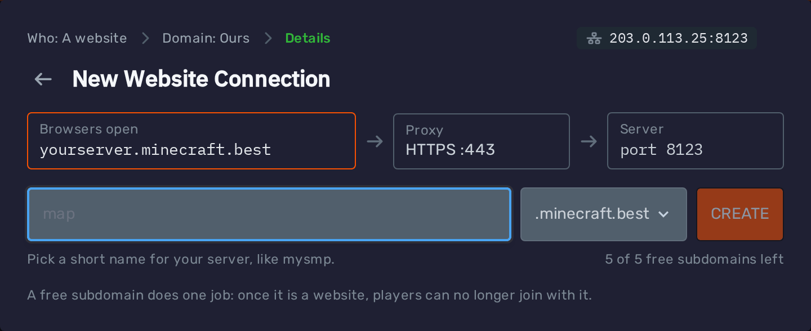

:::caution HEADS UP!
A free subdomain does one job. Once it is used for a website, players can no longer join with it.
:::

**For your own domain**, pick 'A third party domain', add the **CNAME** record shown at your DNS provider
(see [Adding a CNAME Record](#adding-a-cname-record)), then type your domain and press 'Add' once the record is found.
Behind Cloudflare's proxy, the panel also asks for a [TXT record](#websites-behind-cloudflares-proxy) first:

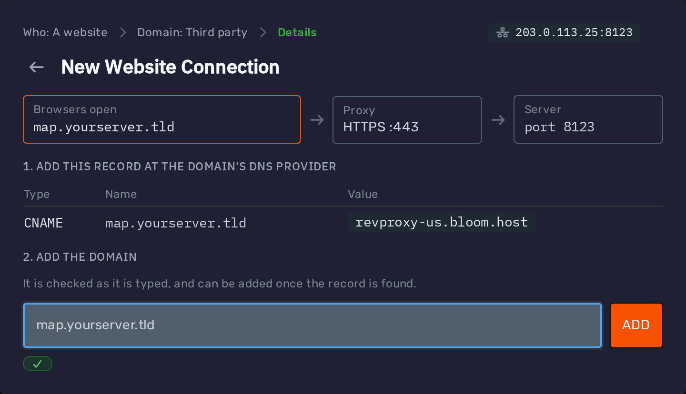

The proxy gets an HTTPS certificate for the domain by itself the first time someone opens it, so the very first visit
can take a few seconds longer.

:::note
Add website connections to the website's own port, not the port players join on. Players cannot join through a website
connection.
:::

### Adding a CNAME Record

Connections to your own domain through our proxies need a CNAME record at your domain's DNS provider. The panel shows
the exact record when you add the connection, including the right proxy to point it at for your server's location.

Here is how it looks in Cloudflare for `subdomain.example.com`:

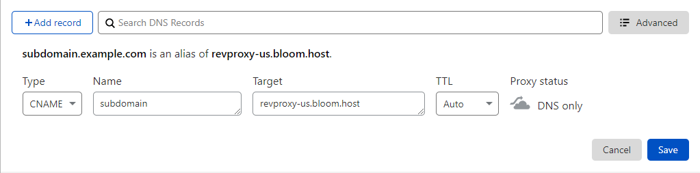

- **Type**: `CNAME`
- **Name**: The part of the domain before your domain name, such as `map` for `map.example.com`. To use the domain
  itself, such as `example.com`, most providers use `@`.
- **Target**: The proxy shown in the panel.

For a website, you can keep Cloudflare's proxy (orange cloud) on for the record. The panel then asks for one more
record, see [Websites Behind Cloudflare's Proxy](#websites-behind-cloudflares-proxy). For players, the record has to be **DNS only** (grey cloud),
since Cloudflare's proxy only passes web ports on.

DNS changes can take anywhere from a few minutes to a few hours to reach everyone. You can check your record with
the [DNSChecker CNAME lookup](https://dnschecker.org/#CNAME).

### Websites Behind Cloudflare's Proxy

This only applies to website connections. A domain for players has to be **DNS only** (grey cloud), see
[Players Through the TLS Proxy](#players-through-the-tls-proxy).

If your website's domain uses Cloudflare's proxy (orange cloud), Cloudflare hides where the record points, so the panel
cannot see that the domain is yours. It shows the domain as 'Cloudflare proxied' and asks for a TXT record as well:

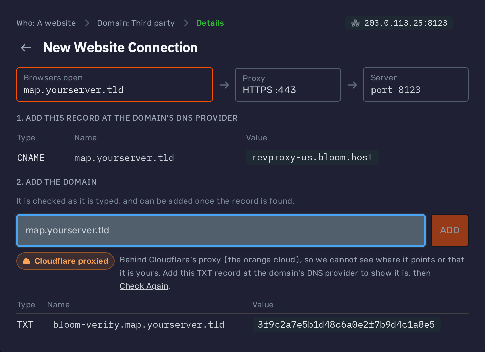

1. At your domain's DNS provider, add the **TXT** record shown. Its name is `_bloom-verify.` followed by your domain,
   such as `_bloom-verify.map.yourserver.tld`, and its value is a code the panel gives you for this server and domain.
2. Press 'Check Again'. Once the TXT record is found, you can press 'Add'.

You can keep Cloudflare's proxy on the whole time, and leave the TXT record in place afterwards. The CNAME record still
has to point at our proxy, and the SSL/TLS encryption mode has to be set to **Full**.

### Connection Status

Each connection shows whether its DNS leads to your server:

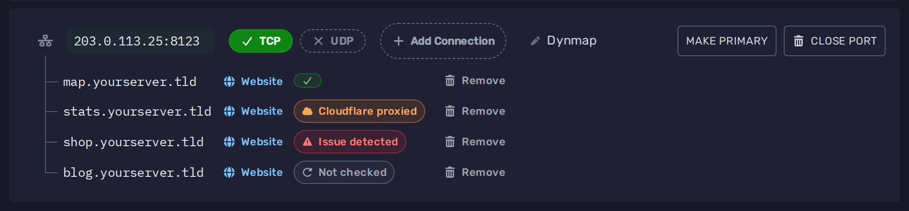

- **✓**: Everything is set up. Free subdomains always show this, since we manage their DNS.
- **Cloudflare proxied**: A website's domain is behind Cloudflare's proxy (orange cloud), which hides where it points,
  so the panel cannot check it. That is fine as long as the record is a CNAME to our proxy and the SSL/TLS encryption
  mode is set to **Full**.
- **Issue detected**: The record is missing or points somewhere else. A domain for players that is behind Cloudflare's
  proxy shows this too, since players cannot join through it. Set its record to **DNS only** (grey cloud).
- **Not checked**: The lookup failed just now, which says nothing about the record. Click it and press 'Check Again' in
  a moment.

Click 'Issue detected' to see what is wrong and the exact record to set. Once you have fixed it, press 'Check Again':

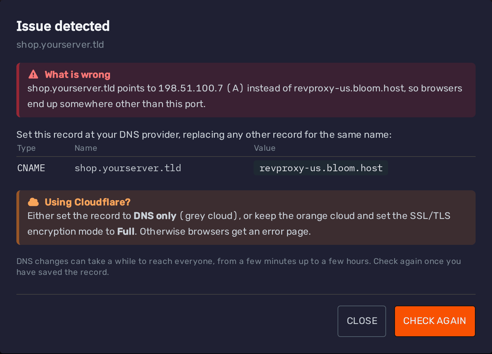

### Removing a Connection

To remove a connection, press the 'Remove' button next to it:

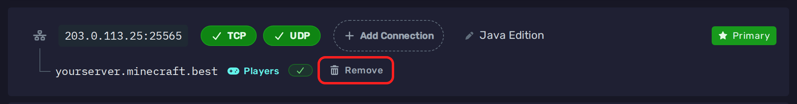

Removing a free subdomain deletes it, and you can create it again later as long as nobody else has taken the name.

Removing your own domain only removes it from the panel. Its DNS record stays at your DNS provider, so remove it there
if you no longer need it.
